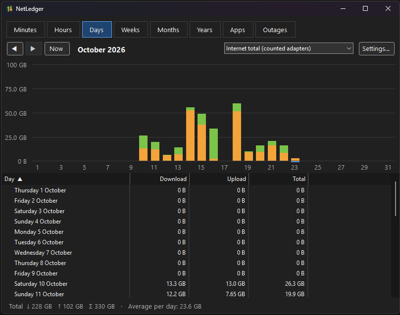
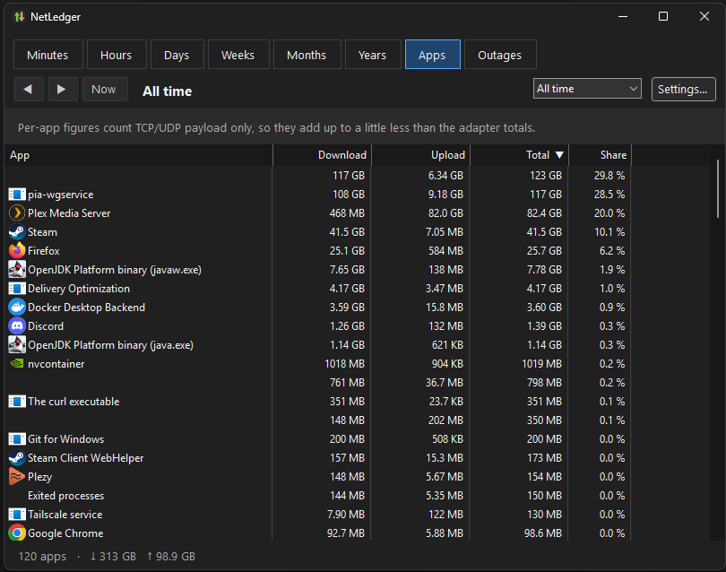

# NetLedger

A lightweight internet usage monitor for Windows 11, in the spirit of NetworX.


- **Live speeds on the taskbar**: upload and download, with an optional mini graph, sitting right next to the tray icons.
- **History**: usage per minute, hour, day, week, month and year, per adapter, in a statistics window.
- **Per-app usage**: which programs used how much, kept per hour forever.
- **Monthly quota**: a data cap with a custom billing day, notifications at chosen percentages, and a projection.
- **Outage log**: when the internet dropped and for how long.
- **Backup & restore**: the whole history in one file, with undo.

## Screenshots





## How it works

NetLedger is two programs:

| Part | Runs as | Does |
|---|---|---|
| `NetLedger.Service.exe` | Windows service (LocalSystem) | Reads adapter byte counters every second, attributes traffic to apps, checks connectivity, and stores everything in SQLite under `%ProgramData%\NetLedger` |
| `NetLedger.exe` | You, at sign-in | Draws the taskbar widget, the statistics and settings windows, and quota notifications |

They talk over a local named pipe. The live taskbar speeds are measured by `NetLedger.exe` itself, so the widget keeps working even if the service is stopped. The service is only needed for history.

Some details worth knowing:

- **Adapter totals** come from Windows' own interface counters (`GetIfTable2`), the same numbers Task Manager uses.
  - Only physical adapters count toward the internet total by default. VPN tunnels and virtual switches carry traffic that also crosses a physical adapter, so counting them too would double it. You can change this per adapter in Settings → Adapters.
  - VPN tunnels and the WSL/Hyper-V switch get a new Windows ID every time they connect or start. NetLedger recognises them by name, so each keeps one history and one setting.
- **Per-app usage** comes from the kernel's network event trace (`Microsoft-Windows-Kernel-Network` ETW provider), which reports the process and payload size of every TCP and UDP send and receive. That requires administrator rights, which is why recording lives in a service.
  - It counts payload only, so per-app totals land a little under the adapter totals. The difference is shown as "Other".
  - Apps are grouped by program file and name, so an app that installs each update into a new folder (Discord, Microsoft Store apps) stays one app.
  - Windows' shared service host (`svchost.exe`) is split by the services it runs. Common network services get their English names (Delivery Optimization, Windows Update, …); others keep the name Windows gives them.
  - When two different programs share a name, their file name is shown after it, e.g. "OpenJDK Platform binary (javaw.exe)".
  - Traffic the kernel handles itself (such as file sharing) shows up as "System (kernel)".
- **Times** are stored in UTC and grouped in local time when shown, so daylight-saving changes come out right.
- **Outages** are detected by fetching `http://www.msftconnecttest.com/connecttest.txt` once a minute (every 10 seconds while offline). That's the same check Windows uses for its "No internet" indicator. The address and interval can be changed, or the check turned off, in Settings → Connectivity.
- **The taskbar widget** is a transparent child window inside the Windows 11 taskbar, since Windows 11 has no API for taskbar toolbars. If Windows ever stops allowing that, switch Settings → Taskbar → Placement to *Floating*.

## Install

1. Install the [.NET 10 Desktop Runtime (x64)](https://dotnet.microsoft.com/download/dotnet/10.0) if you don't have it. The installer checks for it.
2. Download `NetLedger-Setup-<version>.exe` from [Releases](https://github.com/Willshaper/NetLedger/releases) and run it. It asks for administrator rights once, to register the service.

The installer isn't code-signed, so Windows SmartScreen may warn the first time: choose **More info → Run anyway**.

Running the installer again updates an existing install and keeps your history. Uninstalling removes the service, and asks whether to keep your recorded history.

## Using it

- **Hover** the taskbar readout for today's and this month's totals, and the quota if one is set.
- **Click** it to open statistics.
  - Click a bar (or double-click a row) to drill down from year → month → day → hour → minute.
  - ← and → step between periods.
  - Click a column header to sort by it; click again to reverse.
  - **Settings…** at the top right opens the settings.
- **Right-click** it for settings, backup and restore.
- Running `NetLedger.exe` again while it's already running opens the statistics window.

## Build from source

Requires the .NET 10 SDK. [Inno Setup 6](https://jrsoftware.org/isinfo.php) is optional and only needed for the installer.

```powershell
dotnet build NetLedger.slnx
dotnet test --project tests/NetLedger.Tests
.\scripts\publish.ps1            # publish to artifacts\publish\win-x64 and build the installer
```

For development, the service can run in a console with its own data folder:

```powershell
src\NetLedger.Service\bin\Debug\net10.0-windows\NetLedger.Service.exe --console --data .\devdata
```

A few things to know about the console service:

- Per-app tracking only works in an elevated console.
- It can't answer the tray app while an installed NetLedger service is running, because both use the same pipe name. Stop the installed service first.
- To run the published build as a real service without the installer, use `scripts\install-dev.ps1` from an elevated prompt. It copies the build to `%ProgramFiles%\NetLedger-dev` and registers the service from there, because a SYSTEM service shouldn't run from a folder your user account can write to. `-Remove` undoes it.

## Releasing

GitHub Actions builds and tests every push to `main`. To publish a release:

1. Set `<Version>` in `Directory.Build.props` (e.g. `0.2.0`) and commit.
2. Tag the commit with the same version and push the tag:

   ```powershell
   git tag v0.2.0
   git push origin v0.2.0
   ```

The release workflow builds the installer and publishes it as a GitHub Release, with every commit message since the previous tag as the notes. It refuses a tag that doesn't match `<Version>`.

## Project layout

```
src/NetLedger.Core      shared: interface counters, period maths, formatting, pipe protocol, backup format
src/NetLedger.Service   the Windows service: collection, ETW, outage checks, SQLite storage, pipe server
src/NetLedger.Tray      the WinForms app: taskbar widget, statistics, settings, notifications
tests/NetLedger.Tests   unit tests (DST handling, billing cycles, counters, storage, import/export, merging)
installer/              Inno Setup script
.github/workflows/      CI (build and test) and the tag-triggered release
scripts/                publish, dev install and icon scripts
docs/images/            screenshots used in this README
```

## Privacy

Everything stays on your PC. The only network request NetLedger makes is the connectivity check described above, and you can turn it off. The pipe the tray app uses refuses connections from other computers. The service's data folder is readable only by SYSTEM and administrators.

## License

[MIT](LICENSE)
